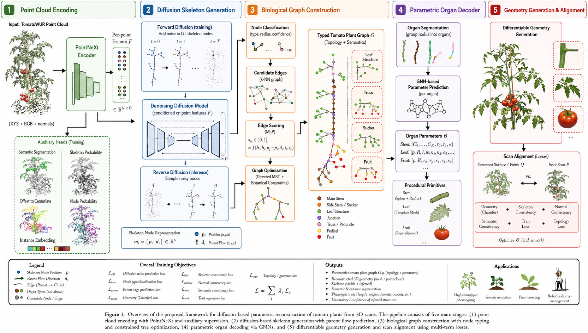

# PhytoDiff

PhytoDiff is a research project for reconstructing structured, parametric tomato
plant models from 3D point clouds. The goal is to recover plant structure from
incomplete observations, represent it as a biological graph, and generate organ
geometry that can be aligned with the observed scan.

The project follows a **five-stage pipeline**. Current development and experiments
focus on **Stage 1: point cloud encoding** and **Stage 2: skeleton generation**.
The later stages define the path from reconstructed skeletons to complete
parametric plants; their integration with the current models is still pending.

## Pipeline overview

[](docs/Overview.png)

*Overview of the proposed PhytoDiff pipeline. The figure illustrates the full
research design; the supported encoder and skeleton-model choices are described
below.*

[View the overview figure at full size](docs/Overview.png).

| Stage | Purpose | Current status |
| --- | --- | --- |
| **1. Point cloud encoding** | Extract point and global features, semantic labels, skeleton probabilities, centreline offsets, and junction probabilities. | Implemented; active development and evaluation. |
| **2. Skeleton generation** | Reconstruct skeleton nodes and parent relationships, including structure missing from partial observations. | Implemented; active development and evaluation. |
| **3. Biological graph construction** | Assign anatomical types and roles, score connections, and enforce biological graph constraints. | Supporting modules exist; integration pending. |
| **4. Parametric organ decoding** | Group graph structure into organs and predict stem, leaf, and optional fruit parameters. | Supporting modules exist; integration pending. |
| **5. Geometry generation and alignment** | Generate organ surfaces and align the reconstructed plant with the input scan through geometric and structural objectives. | Supporting modules exist; integration pending. |

Stage 2 can already export skeleton trees, and AG-GFM also exports the shared
`PlantGraph` representation. These outputs do not imply that the separate Stage 3
biological graph model or the complete five-stage reconstruction workflow is
integrated. The Stage 3–5 training and full-pipeline inference entry points
currently report an explicit integration error.

The intended final outputs include a typed plant graph, parametric organs,
reconstructed geometry, phenotypic traits, and confidence estimates. The current
training and inference workflows produce Stage 1 predictions and Stage 2
skeletons.

## Data and observation views

PhytoDiff uses a shared preprocessing and loading interface for three tomato
point-cloud datasets:

| Dataset | Selection value | Configuration | RGB |
| --- | --- | --- | --- |
| TomatoWUR v3 | `tomatowur` | [tomatowur_v3.yaml](configs/data/tomatowur_v3.yaml) | Available |
| TomatoPGT v1 | `tomatopgt` | [tomatopgt_v1.yaml](configs/data/tomatopgt_v1.yaml) | Available |
| Pheno4D Tomato | `pheno4d` | [pheno4d_tomato.yaml](configs/data/pheno4d_tomato.yaml) | Unavailable; represented explicitly |

Use `combined` to select the union of the source datasets. Raw datasets remain
outside the Docker image and are read in place. Their default locations are
`data/TomatoWUR`, `data/TomatoPGT_v1.0`, and `data/Pheno4D`.

Each processed plant provides a full cloud and two derived partial views:

- `full`: the complete processed input cloud.
- `top_down`: a fixed view looking along −Z.
- `side`: a fixed view from +Y looking along −Y.

Selected views share the same full skeleton target. Coordinates use metres and
Z up, with the inverse source transform retained in metadata. Pheno4D's source
units and missing RGB are handled by its adapter.

Source-plant identities and train/validation/test splits are preserved, including
across repeated scans and derived views. Validation selects checkpoints; test
results are reserved for held-out evaluation. The processed manifest records
source membership and split sizes.

## Getting started with Docker

The repository uses Docker Compose for preprocessing, training, evaluation, and
visualisation. Run commands from the repository root. GPU training requires a
compatible NVIDIA driver and NVIDIA Container Toolkit; raw data and outputs are
mounted into the containers rather than copied into the image.

Run `make` or `make help` to see the grouped command catalogue. Commands follow
the workflow: `data-*`, `stage1-*`, `stage2-*`, and `check-*`. Existing command
names remain available as compatibility aliases; configuration variables and
output paths are unchanged.

### Build and check the environment

```bash
docker compose -f docker/docker-compose.yml build train preprocess

docker compose -f docker/docker-compose.yml run --rm train \
  python -c "import torch; print(torch.__version__, torch.cuda.is_available())"
```

The CUDA check should report `True` on the training host. See
[docker/docker-compose.yml](docker/docker-compose.yml) for services and mounts.

### Prepare and inspect the data

Place the source datasets at their configured paths, then run the adapters for
the sources you intend to use:

```bash
make data-prepare-tomatowur
make data-prepare-tomatopgt
make data-prepare-pheno4d
make data-visualize DATASET_VIS_COUNT=3
```

The adapters write a shared `data/dataset/manifest.json` and globally numbered
plant directories containing full clouds, derived views, and targets. Unchanged
completed instances are skipped on reruns. To generate partial views from
existing full caches:

```bash
make data-generate-top-down
make data-generate-side
```

These Makefile targets run in the Compose `preprocess` service. See
[data contracts](docs/DATA.md) and the source configurations for annotation and
conversion details.

## Stage 1: point cloud encoding

Stage 1 learns a representation of the observed plant and predicts semantic
classes, skeleton probabilities, offsets towards centrelines, and junction
probabilities. Its features and predictions provide conditioning for subsequent
skeleton reconstruction.

Supported backbones are **KPConvX** (`kpconvx`, the default), **PointNeXt**
(`pointnext`), and **Sonata PTv3** (`sonata_ptv3`). Run
`make stage1-prepare-models` before using Sonata to prepare its pinned pretrained
checkpoint.

The standard training command uses KPConvX, the combined dataset, and all three
views:

```bash
make stage1-train
```

Checkpoints are written to `outputs/encoder/combined/kpconvx/`. Set
`STAGE1_EPOCHS` and `STAGE1_TRAIN_OUTPUT` to configure this run. A direct Docker
command provides dataset, view, and encoder selection; for example:

```bash
docker compose -f docker/docker-compose.yml run --rm train \
  python -m tomato_recon.train.train_encoder --config-name encoder \
  model.encoder.name=kpconvx data.dataset=tomatowur \
  'data.pcl_types=[top_down]' \
  output.dir=outputs/encoder/tomatowur/kpconvx/top_down
```

Stage 1 accepts any nonempty combination of `full`, `top_down`, and `side`.
Use distinct output directories for different configurations. To inspect the
standard checkpoint's held-out predictions:

```bash
make stage1-visualize-test
```

The Stage 1 experiment workflows compare backbones, view combinations, and
cross-dataset generalisation:

```bash
make stage1-compare-backbones
make stage1-compare-views
make stage1-compare-datasets
```

Ablation 2 uses the validation-selected architecture from Ablation 1. See
[training and evaluation](docs/TRAINING.md) for experiment configuration,
checkpoint resume, metrics, and visualisation options.

## Stage 2: skeleton generation

Stage 2 reconstructs a skeleton from the observed cloud. Skeleton generation is
modular: the model choice is separate from the Stage 1 backbone and, where the
backend supports them, the selected dataset and views.

| Backend | Approach | Supported workflow |
| --- | --- | --- |
| **DiffTS** (`diffts`) | Diffusion over skeleton positions and parent directions, with `points` or `points_stage1` conditioning. | Existing combined-dataset, all-view training; standalone top-down inference. |
| **AG-GFM** (`aggfm`) | Anatomical observed/latent seeds, structure-aware partial matching, and conditional graph flow over positions and existence. | Individual or combined datasets; any nonempty combination of the three views. |

Both workflows predict node counts without reading target counts during
inference. The Stage 1-conditioned models keep Stage 1 frozen by default, with
optional fine-tuning. AG-GFM loads the complete trained Stage 1 encoder and its
prediction heads directly from the checkpoint.

### Train a skeleton model

The default command trains both DiffTS conditioning variants in sequence:

```bash
make stage2-train

# Run either DiffTS variant separately.
make stage2-train-diffts-points
make stage2-train-diffts-stage1
```

To select AG-GFM:

```bash
make stage2-train STAGE2_MODEL=aggfm

make stage2-train STAGE2_MODEL=aggfm \
  STAGE2_DATASET=tomatowur STAGE2_PCL_TYPES="top_down"

make stage2-train STAGE2_MODEL=aggfm \
  STAGE2_DATASET=pheno4d STAGE2_PCL_TYPES="side"
```

`STAGE1_CHECKPOINT` defaults to the output of `make stage1-train`. AG-GFM uses
`STAGE2_ENCODER_CHECKPOINT`, which defaults to that same checkpoint. Set the
appropriate variable when using a checkpoint from another compatible run.

DiffTS checkpoints remain under `outputs/diffts/points/` and
`outputs/diffts/points_stage1_adapter/`. AG-GFM checkpoints are organised as
`outputs/aggfm/<dataset>/<view_combination>/`. Each backend retains its own
configuration, checkpoint schema, and compatibility checks.

### Evaluate, infer, and visualise

For an AG-GFM model trained on the default combined/all-view configuration:

```bash
make stage2-evaluate STAGE2_MODEL=aggfm STAGE2_SPLIT=test

make stage2-infer STAGE2_MODEL=aggfm \
  STAGE2_INPUT=data/dataset/plant_000001/top_down.npz \
  STAGE2_INFER_VIEW=top_down \
  STAGE2_INFER_OUTPUT=outputs/aggfm/predictions/plant_000001

make stage2-visualize STAGE2_MODEL=aggfm \
  STAGE2_SPLIT=val STAGE2_SELECTED_VIS_COUNT=3
```

Use the actual processed plant path for inference. Supply the training dataset
and view selection to resolve other checkpoints, or set `STAGE2_CHECKPOINT`
explicitly. Standalone inference reads point inputs and metadata without opening
ground-truth targets. Validation/test visualisations can display targets for
comparison. AG-GFM saves images, graphs, and trajectories separately under
`visualizations/<split>/{images,graphs,trajectories}/<view>/`, using plant IDs as
filenames. It prints progress for each plant/view and flow step, including saved
paths, elapsed time, and ETA. Set `STAGE2_SELECTED_VIS_COUNT=0` to render every
plant in the selected split.

The existing DiffTS visualisation command remains available:

```bash
make stage2-visualize-diffts-test
```

See [training and execution](docs/TRAINING.md) for DiffTS commands and
[AG-GFM](docs/AGGFM.md) for architecture, losses, dataset/view selection, resume,
evaluation metrics, and flow visualisation.

## Configuration and reproducibility

Configuration starts with [configs/config.yaml](configs/config.yaml), then merges
stage-specific YAML and command-line overrides. The main configuration locations
are:

| Area | Location |
| --- | --- |
| Dataset preparation and source selection | `configs/data/` |
| Stage 1 encoders | `configs/encoder/` |
| Stage 2 DiffTS | `configs/diffusion/default.yaml` |
| Stage 2 AG-GFM | `configs/flow_matching/aggfm.yaml` |
| Biological graph model | `configs/graph/` |
| Parametric organs | `configs/parametric/` |
| Joint geometry/alignment experiments | `configs/experiment/` |

Training records resolved configurations, checkpoint provenance, dataset
compatibility, and validation metrics. Resume uses `--resume PATH` at the Python
entry point; Makefile variables differ by workflow and are documented in the
training guides. Keep preprocessing and checkpoint compatibility intact, use
separate experiment directories, and select models using validation data.

The current Python package and CLI retain the names `tomato_recon` and
`tomato-recon`. These are implementation entry points within the PhytoDiff project.

## Repository layout

```text
configs/                 Dataset, model, and experiment configurations
src/tomato_recon/
  data/                  Source adapters, preprocessing, views, and shared schemas
  models/encoders/       Stage 1 backbones and prediction heads
  models/diffusion/      Stage 2 diffusion models
  models/flow_matching/  Stage 2 graph flow matching models
  models/graph/          Biological graph components
  models/parametric/     Parametric organ components
  geometry/              Curves, tubes, leaves, and other geometry utilities
  train/                 Stage-specific training entry points
  evaluation/            Geometry, skeleton, graph, and trait metrics
  export/                Graph, PLY, and USD export utilities
scripts/                 Data preparation, experiments, evaluation, and previews
tests/                   Unit/integration tests and synthetic fixtures
docs/                    Pipeline overview and technical documentation
data/                    External raw datasets and processed caches
outputs/                 Checkpoints, reports, and visualisations
```

## Tests and smoke checks

Run the test suite in the Docker development image:

```bash
make check-tests
```

Tests cover dataset/view contracts, Stage 1 extraction, Stage 2 generation,
matching and topology, checkpoint compatibility/resume, target-free inference,
and the supporting graph, geometry, and export modules. The AG-GFM CUDA smoke
test exercises a forward pass, backward pass, optimiser update, and inference:

```bash
make check-smoke-aggfm
```

The DiffTS training smoke script also requires the prepared combined dataset,
an all-view Stage 1 checkpoint, and a GPU:

```bash
make check-smoke-diffts
```

These checks verify implementation behavior; reconstruction quality requires
separate training and held-out evaluation experiments.

## Documentation

- [Training and execution](docs/TRAINING.md)
- [Dataset preparation and contracts](docs/DATA.md)
- [Model and checkpoint contracts](docs/MODEL_CONTRACTS.md)
- [AG-GFM architecture and workflow](docs/AGGFM.md)
- [USD export](docs/USD_EXPORT.md)

## License and attribution

See [LICENSE](LICENSE) for the project license and
[THIRD_PARTY_NOTICES.md](THIRD_PARTY_NOTICES.md) for upstream code attribution,
including the DiffTS adaptation. Dataset access and reuse remain subject to each
source dataset's terms.
